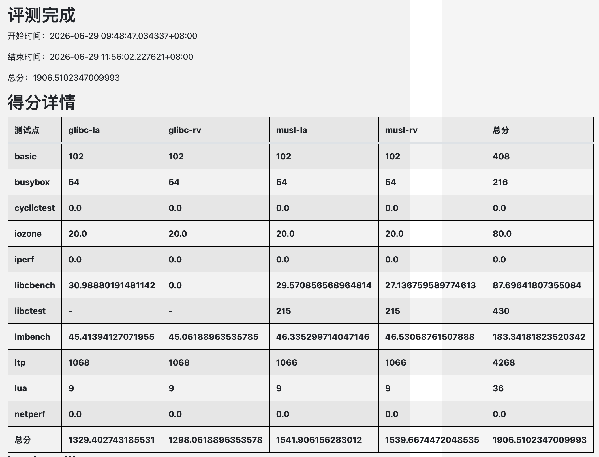
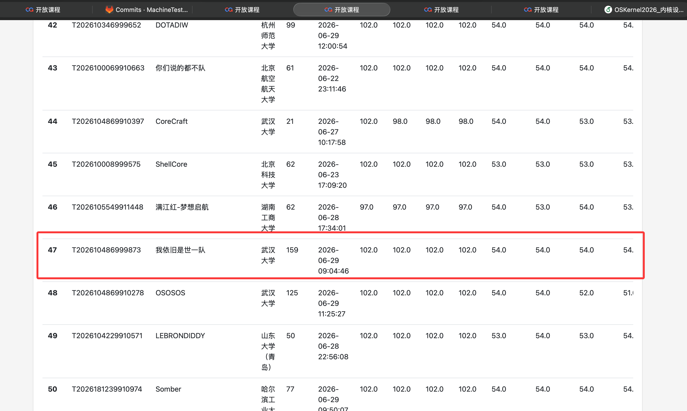
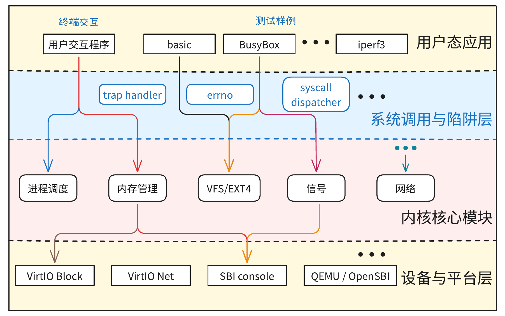

# ScintillaOS

ScintillaOS 是武汉大学参赛队面向全国大学生操作系统设计大赛开发的操作系统内核。系统采用 Rust 编写，基于 rCore 教学内核提供的基础执行链路继续扩展，目标是在 QEMU 评测环境中提供兼容 RISC-V Linux ABI 的用户程序运行环境，并支撑官方 basic、busybox、lua、libctest、libcbench、lmbench、iozone、LTP 等测试。

“Scintilla” 有“火花”之意。这个名字表示本项目并不是从一个完整成熟内核出发做局部调参，而是在 rCore 的基础火花上，沿启动、内存、进程、文件系统、设备驱动和网络支持逐步扩展，形成一个可运行、可评测、可继续演进的竞赛内核。

## 分支说明

本项目采用开发分支和评测分支分离的方式管理：

| 分支 | 用途 |
| --- | --- |
| `main` | 日常开发、功能沉淀、文档整理和后续维护。 |
| `MachineTest` | 官方评测提交分支，用于适配比赛测试入口和评测脚本。 |

仓库中的 `documents/` 目录保存了开发日志、架构说明、VFS/Ext4 迁移记录、各测试接入记录和问题排查文档。总开发日志位于 `documents/worklog.md`。

## 评测成绩

截至 2026 年 6 月 29 日 12:00，ScintillaOS 在全国大学生操作系统设计大赛平台取得 1906 分，排行榜位列第 47 名。下图来自最终内核设计报告。





## 总体架构

ScintillaOS 可分为用户态、系统调用与陷阱层、内核核心子系统和设备层四个层次。用户程序通过系统调用进入内核，内核将请求分发给进程、内存、文件系统、信号和网络等模块；底层通过 VirtIO 块设备、VirtIO 网卡和串口为上层能力提供 I/O 支撑。



核心设计特点包括：

- 单 CPU 同步模型，采用 FIFO 就绪队列和时钟中断驱动的轮转调度。
- RISC-V 为主要评测目标，同时保留 LoongArch 构建和适配路径。
- RISC-V 使用 Sv39 三级页表，页面大小为 4 KiB。
- 文件系统采用 Ext4，并通过 `lwext4_rust` 调用嵌入式 lwext4。
- 支持 QEMU Virt 平台、OpenSBI、VirtIO 块设备和 VirtIO 网卡。
- 系统调用编号遵循 RISC-V Linux ABI，在陷阱处理流程中统一分发。

## 项目框架

| 路径 | 说明 |
| --- | --- |
| `os/src` | 内核主体，包括启动、陷阱、进程、内存、文件系统、网络、驱动和系统调用。 |
| `user/src` | 用户态运行时、系统调用封装、测试 runner 和辅助程序。 |
| `lwext4_rust` | lwext4 的 Rust 绑定及块设备适配层。 |
| `basic` | basic 测试程序、用户态测试资源和构建脚本。 |
| `documents` | 架构设计、开发日志、VFS/Ext4 迁移、LTP/libctest/netperf 等专题记录。 |
| `vendor` | 离线依赖和第三方组件，包括 polyhal、smoltcp、virtio-drivers 等。 |
| `testsuits-for-oskernel` | 官方测试套件相关资源。 |

内核入口位于 `os/src/main.rs`。启动后，系统依次初始化内核堆、物理帧分配器、页表、VirtIO 设备和根 Ext4 文件系统，然后装载 `/bin/initproc` 进入就绪队列。用户态通过 `ecall` 进入统一陷阱入口，系统调用层负责参数转换、用户地址校验和模块分发。

## 关键能力

| 模块 | 已实现能力概述 |
| --- | --- |
| 进程与调度 | `fork`、`clone`、`exec`、`waitpid`、`exit`、线程组、父子关系、阻塞唤醒和基础信号语义。 |
| 内存管理 | ELF 装载、用户栈、`brk`、`mmap`、`munmap`、`mprotect`、按需分页、COW 和用户缓冲区校验。 |
| 文件系统 | VFS、Dentry 缓存、Ext4、双盘挂载、路径解析、普通文件、目录、pipe、procfs 和设备文件。 |
| 系统调用 | 按 Linux RISC-V ABI 实现文件、进程、时间、信号、内存和网络相关系统调用。 |
| 网络 | socket fd 统一管理，本地 TCP/UDP 路径，`bind`、`listen`、`connect`、`accept4`、`sendto`、`recvfrom` 等接口。 |
| 测试链路 | 支持 basic、busybox、lua、libctest、libcbench、lmbench、iozone、LTP 子集等官方评测项目。 |

## 构建与运行

常用命令如下：

```bash
# 构建比赛提交产物：kernel-rv、kernel-la、disk.img
make all

# 单架构构建
make kernel ARCH=riscv64
make kernel ARCH=loongarch64

# 构建文件系统镜像
make fs-img ARCH=riscv64

# 本地单盘运行
make run ARCH=riscv64

# 本地双盘运行，模拟官方评测环境
make run-dual ARCH=riscv64 TEST_DISK=fs-img.img
```

## 文档索引

| 文档 | 内容 |
| --- | --- |
| `documents/worklog.md` | 团队按日期记录的总开发日志。 |
| `documents/操作系统架构全景.md` | OS 整体架构和模块关系说明。 |
| `documents/VFS与Dentry实现原理.md` | VFS、Dentry、Mount 和路径解析设计。 |
| `documents/ext4迁移记录2026-04-22.md` | 从 rCore 基线迁移到 ext4 的早期记录。 |
| `documents/libctest开发文档.md` | 为 libctest 补齐的内核语义和开发说明。 |
| `documents/ltp测试指南.md` | LTP 集成和运行说明。 |
| `documents/netperf测试指南.md` | netperf 差距分析和运行指南。 |
| `documents/MachineTest近期改动迁移说明2026-06-29.md` | MachineTest 近期改动迁移到 main 的说明。 |

## 总结与展望

ScintillaOS 完成了从教学内核到竞赛评测内核的系统性扩展。项目通过 VFS 和 lwext4 构建了可挂载的 Ext4 文件系统，通过双盘结构适配官方评测流程，通过进程、内存、信号和 Linux ABI 系统调用支撑复杂用户程序，并接入多类官方测试套件。Ext4 迁移、Dentry 缓存、按需分页与 COW、socket 文件描述符统一管理，是本项目实现中的关键工作。

后续我们希望继续推进以下方向：

- 回归并强化 COW、信号返回、阻塞/唤醒和线程退出路径，提升复杂用户程序稳定性。
- 补齐 LTP 中依赖较强的系统调用语义，扩大可稳定通过的 LTP 子集。
- 完善网络协议栈和本地 socket 路径，提升 netperf、iperf 等网络测试的稳定性。
- 优化 VFS Dentry 缓存和回收策略，减少长测中目录项和文件对象的生命周期风险。
- 继续保留开发日志、测试日志和提交记录，确保每一次修复都有可追溯证据。
