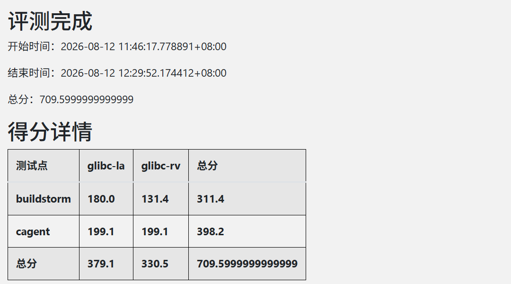
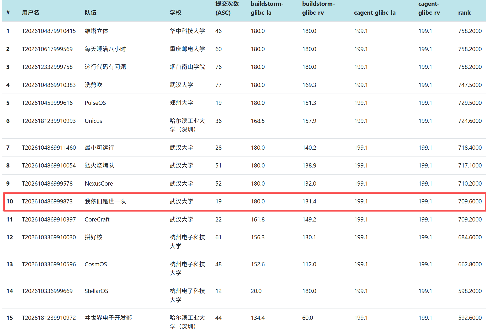

# ScintillaOS

ScintillaOS 是武汉大学参赛队面向全国大学生操作系统设计大赛开发的操作系统内核。系统采用 Rust 编写，基于 rCore 教学内核提供的基础执行链路继续扩展，目标是在 QEMU 评测环境中为 RISC-V64 与 LoongArch64 提供兼容 Linux ABI 的用户程序运行环境。系统除支持 basic、BusyBox、Lua、libctest、libcbench、lmbench、iozone 和 LTP 子集等初赛负载外，还在决赛阶段完成了双架构 SMP、glibc 用户态、CAgent 和 Rust/Cargo BuildStorm 复杂构建链路的适配。

“Scintilla” 有“火花”之意。这个名字表示本项目并不是从一个完整成熟内核出发做局部调参，而是在 rCore 的基础火花上，沿启动、内存、进程、文件系统、设备驱动和网络支持逐步扩展，形成一个可运行、可评测、可继续演进的竞赛内核。

## 演示视频

视频文件较大，使用百度网盘分享：

- 初赛讲解视频：`ScintillaOS_讲解视频.mp4`，[下载链接](https://pan.baidu.com/s/1nCYVl_1L8v0gYT7QHy2ewA?pwd=n45u)，提取码：`n45u`。
- 决赛线上赛答辩视频：`ScintillaOS_决赛线上赛答辩视频.mp4`，[下载链接](https://pan.baidu.com/s/1AXpKeBBs9nBHoB2v1hiMCA?pwd=jd45)，提取码：`jd45`。

## 分支说明

本项目采用最终成果分支与各阶段评测入口分离的方式管理：

| 分支 | 用途 |
| --- | --- |
| `main` | 最终提交与成果归档分支，汇总初赛和决赛阶段最终保留的内核能力、文档及后续维护内容；默认保留 Shell 入口，便于人工回归。 |
| `finalsubmission` | 决赛官方测评分支，保留决赛自动评测入口：挂载测试盘、进入 glibc 环境，依次执行 CAgent 与 BuildStorm，最后关机。 |
| `MachineTest` | 初赛官方测评分支，保留初赛自动评测入口和对应脚本，现作为初赛封板记录。 |

从评测分支向 `main` 汇总修改时，自动运行测试的 `user/src/bin/initproc.rs` 与磁盘镜像不随普通内核改动迁移，因此 `main` 可以在保留最终实现的同时继续使用 Shell 做本地测试。仓库中的 `documents/` 目录保存了开发日志、架构说明、VFS/Ext4 迁移记录、SMP 与 BuildStorm 调试记录、各测试接入记录和问题排查文档。总开发日志位于 `documents/worklog.md`。

## 评测成绩

### 初赛

截至 2026 年 6 月 29 日 12:00，ScintillaOS 在全国大学生操作系统设计大赛初赛平台取得 1906 分，排行榜位列第 47 名。


### 决赛

在 2026 年 8 月 12 日的最终官网评测中，ScintillaOS 取得 **709.6 分**，排行榜位列 **第 10 名**。两个架构的 CAgent 十项测试均全部通过；BuildStorm 的工具链检查、最小 Rust 工程、完整 release 构建、产物大小检查与产物启动检查也均完成。

| 测试项 | LoongArch64 glibc | RISC-V64 glibc | 合计 |
| --- | ---: | ---: | ---: |
| CAgent | 199.1 | 199.1 | 398.2 |
| BuildStorm | 180.0 | 131.4 | 311.4 |
| **总分** | **379.1** | **330.5** | **709.6** |





## 总体架构

ScintillaOS 可分为用户态、系统调用与陷阱层、内核核心子系统和设备与平台层四个层次。静态链接程序和 glibc 用户程序通过统一陷阱入口进入内核；系统调用层负责 Linux ABI 解码、用户地址校验与模块转发；任务、内存、VFS/Ext4、信号、事件 I/O 和网络等核心子系统共同维护进程资源；底层通过 VirtIO 块设备、VirtIO 网卡、串口和架构相关代码适配 QEMU RISC-V virt 与 LoongArch virt 平台。


核心设计特点包括：

- 双架构 SMP：当前配置下，RISC-V64 最多使用 8 个应用 CPU，LoongArch64 最多使用 12 个应用 CPU；实际在线 CPU 由启动阶段动态发布。
- 每 CPU FIFO 就绪队列：任务通过 `enqueued` 和 `running_cpu` 原子状态维持唯一排队、唯一运行所有权，并结合 CPU 亲和性、空闲偷取与 IPI 唤醒。
- 统一并发协议：pipe、wait、futex、poll 和网络 I/O 共用 `Blocking -> WakePending -> Blocked -> Ready` 阻塞唤醒状态机；领域锁、固定锁序和 lockdep 约束跨模块并发。
- 按需虚拟内存：RISC-V 使用 Sv39 三级页表和 4 KiB 页面；地址空间支持 COW、按需 ELF/用户栈装载、文件页缓存、共享 VM 活动 CPU 跟踪与远端 TLB 刷新。
- VFS 与 Ext4 双盘：`VfsSuperBlock`、Dentry、Mount 和 `File` trait 分离命名空间、文件系统实例与打开文件对象，并通过 `lwext4_rust` 访问 Ext4。
- 统一 fd 与事件 I/O：普通文件、管道、eventfd、epoll、Unix 域 socketpair、TCP/UDP socket 和设备对象进入同一文件描述符表。
- 双架构设备适配：RISC-V 使用 VirtIO MMIO 与 OpenSBI；LoongArch 使用 PCI 枚举和 VirtIO PCI 传输，上层任务、VFS、系统调用和网络状态机保持复用。
- Linux ABI 分层：系统调用入口只承担 ABI 解码、参数转换和边界检查，具体语义由进程、内存、文件系统与网络模块实现。


## 项目框架

| 路径 | 说明 |
| --- | --- |
| `os/src` | 内核主体，包括双架构启动与陷阱、SMP 调度、进程、内存、文件系统、网络、驱动、同步原语和系统调用。 |
| `user/src` | 用户态运行时、系统调用封装、Shell、自动评测入口及 SMP 定向测试程序。 |
| `lwext4_rust` | lwext4 的 Rust 绑定及块设备适配层。 |
| `basic` | basic 测试程序、用户态测试资源和构建脚本。 |
| `documents` | 架构设计、开发日志、VFS/Ext4、SMP、CAgent、BuildStorm 和各类问题定位记录。 |
| `vendor` | 离线依赖和第三方组件，包括 polyhal、smoltcp、virtio-drivers 等。 |
| `testsuits-for-oskernel` | 官方测试套件相关资源。 |

内核入口位于 `os/src/main.rs`。主 CPU 依次初始化内核堆、物理帧分配器、页表、陷阱、VirtIO 设备和根 Ext4 文件系统，再装载 `/bin/initproc`。次级 CPU 先建立 per-CPU 存储与 idle 上下文，等待全局初始化和首个任务交接完成后登记 online bit 并进入本地调度循环。用户态通过架构对应的陷阱机制进入统一分发路径，系统调用层负责参数转换、用户地址校验和模块调用。

## 关键能力

| 模块 | 已实现能力概述 |
| --- | --- |
| 进程与调度 | 每 CPU FIFO 队列、IPI、亲和性和统一阻塞唤醒；支持 `fork`、`clone`、`vfork`、`exec`、wait 类调用、线程组、共享 fd/VM/信号动作与僵尸回收。 |
| 内存管理 | `brk`、`mmap`、`munmap`、`mprotect`、`mremap`、COW、按需 ELF 与栈装载、文件页缓存、分片页帧分配和远端 TLB 刷新。 |
| 文件系统 | VFS、Dentry 正负缓存与代际校验、Mount、Ext4 双盘、符号链接、proc/dev、pipe、打开后删除、延迟写回与块缓存。 |
| 信号与同步 | Linux 风格信号帧与 `rt_sigreturn`、线程定向信号、futex wait/wake/requeue/timeout、robust list 和 `clear_child_tid`。 |
| 事件与 IPC | eventfd、epoll、`ppoll`、`pselect6`、管道和 AF_UNIX `SOCK_STREAM`/`SOCK_SEQPACKET` socketpair。 |
| 网络 | VirtIO-Net + smoltcp、IPv4 TCP/UDP、内核本地环回、阻塞/非阻塞 socket、poll 和常用 send/recv 接口。 |
| 系统调用 | 按 Linux ABI 实现 120 多个进程、文件、内存、信号、时间、凭证、事件、IPC 和网络调用，未实现接口明确返回 `ENOSYS`。 |
| 平台与测试 | 支持 RISC-V64 与 LoongArch64 多核、双盘和 VirtIO 网络；完成初赛测试、双架构 CAgent 以及 BuildStorm 工具链与复杂工程构建链路。 |

## 构建与运行

常用命令如下：

```bash
# 构建比赛提交产物：kernel-rv、kernel-la、disk.img、disk-la.img
make all

# 单架构构建
make kernel ARCH=riscv64
make kernel ARCH=loongarch64

# 构建文件系统镜像
make fs-img ARCH=riscv64

# 本地单盘运行
make run ARCH=riscv64

# 本地双盘运行，模拟官方评测环境
make run-dual ARCH=riscv64 TEST_DISK=fs-img.img

# RISC-V 八核运行
make run-smp8

# 指定 LoongArch 核数运行
make run ARCH=loongarch64 QEMU_SMP=12
```

## 文档索引

| 文档 | 内容 |
| --- | --- |
| `documents/worklog.md` | 团队按日期记录的总开发日志。 |
| `documents/操作系统架构全景.md` | OS 整体架构和模块关系说明。 |
| `documents/VFS与Dentry实现原理.md` | VFS、Dentry、Mount 和路径解析设计。 |
| `documents/ext4迁移记录2026-04-22.md` | 从 rCore 基线迁移到 ext4 的早期记录。 |
| `documents/libctest开发文档.md` | 为 libctest 补齐的内核语义和开发说明。 |
| `documents/ltp测试指南.md` | LTP 集成和运行说明。 |
| `documents/netperf测试指南.md` | netperf 差距分析和运行指南。 |
| `documents/2025现场赛RISC-V适配与修改全记录.md` | 2025 现场赛 RISC-V 适配的故障时间线、源码原理、main 合并复盘和验证边界。 |
| `documents/现场赛2025_RISCV验收指南.md` | 2025 现场赛 RISC-V Alpine 构建、网络、Git 和逐项验收流程。 |
| `documents/2026现场赛准备与复测指南.md` | 2026 CAgent/BuildStorm 题目分析、准备分支、两架构正式复测、诊断与性能实验流程。 |
| `documents/Python3.13现场赛模拟题适配与验收指南.md` | 按 2025 形式设计的 Python 3.13 模拟题、内核适配原理、双架构自动/手工验收和验证边界。 |
| `documents/六工具现场赛模拟题适配与验收指南.md` | Make/CMake/Ninja/Cargo/Python/curl 六工具模拟题、内核适配、双架构复现与证据说明。 |
| `documents/MachineTest近期改动迁移说明2026-06-29.md` | MachineTest 近期改动迁移到 main 的说明。 |
| `documents/四核SMP适配与死锁修复全记录.md` | SMP 启动、调度、阻塞状态机、IPI、远端 TLB 和锁诊断记录。 |
| `documents/决赛提交分支迁移与双架构验证记录.md` | `finalsubmission` 迁移、双架构 CAgent/BuildStorm 入口和验证记录。 |
| `documents/BuildStorm题二第一问适配与验证记录.md` | glibc/Rust 工具链、线程组、共享 fd、eventfd/epoll/socketpair 等适配说明。 |
| `documents/BuildStorm题二复杂构建适配与验证记录.md` | BuildStorm 复杂构建的故障定位、正确性修复、性能实验和双架构闭环。 |
| `documents/BuildStorm官网输出10问题定位与终端非阻塞修复.md` | 最终产物启动检查、终端非阻塞与双架构启动 ABI 修复记录。 |

## 总结与展望

ScintillaOS 已从 rCore 教学内核演进为面向 QEMU 双架构竞赛环境的 SMP 内核。系统在 RISC-V64 和 LoongArch64 上形成了从多核启动、进程与线程、COW 和按需内存，到 VFS/Ext4 双盘、VirtIO 块设备与网络、信号/futex、事件 I/O 和 TCP/UDP 的完整执行链；并通过双架构 CAgent 与真实 Rust/Cargo 复杂构建验证了这些模块的组合语义。项目最终取得初赛 1906 分、排名第 47，以及决赛 709.6 分、排名第 10。

项目开发进一步表明，内核正确性不能只由单个系统调用的返回值判断。任务、VMA、页帧、fd、Dentry 和设备对象都具有跨模块生命周期，必须先明确所有权、状态发布、锁顺序和回收边界。决赛阶段使用的 `WakePending` 交接、`SchedulerLock -> TaskLock` 固定顺序、远端 TLB 刷新和 lockdep，使多核环境中的偶发失败能够被描述为可检查的不变量；BuildStorm 也证明了真实复合负载对于发现线程、内存和文件系统边界问题的重要性。

后续我们希望继续推进以下方向：

- 完善每 CPU 队列之间的负载均衡、任务迁移和调度诊断，逐步降低全局 SchedulerLock 的竞争，同时继续保持任务唯一所有权。
- 深化文件系统并发元数据、页缓存回收、写回压力控制和崩溃恢复语义，降低大型构建中的 Ext4 串行区与内存占用。
- 扩大 Linux/POSIX 兼容范围，覆盖更多 LTP 子集、网络协议与 socket 选项，并补充更长时间、多核和高并发回归。
- 强化安全边界与可观测性，继续审计 `unsafe`、用户指针、页表和设备 DMA 路径，完善锁统计、资源快照和故障复现工具。
- 延续源码提交、镜像哈希、QEMU 参数、串口日志和失败样本共同归档的验证方式，确保后续优化仍可复现、可审阅。
